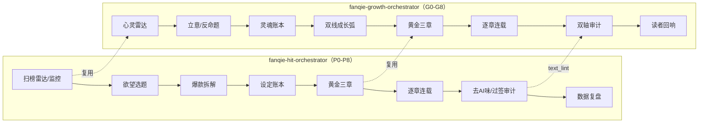

# 番茄小说双总控 Skills（Fanqie Novel Skills）

两个面向**番茄小说**创作的 Agent Skill 总控引擎，遵循 Antigravity / Agent Skills 规范（`skills/<name>/SKILL.md` + `references/` + `templates/` + `scripts/`）。

| Skill | 方向 | 核心公式 |
| :--- | :--- | :--- |
| [`fanqie-hit-orchestrator`](skills/fanqie-hit-orchestrator/SKILL.md) | **爆款 · 欲望满足向** | 欲望靶点 × 压抑-兑现周期 × 章尾钩 |
| [`fanqie-growth-orchestrator`](skills/fanqie-growth-orchestrator/SKILL.md) | **成长 · 真我与良知的精神食粮** | 真实困境 × 错误信念被代价击碎 × 主动选择 × 良知回响 |

## 流程



- **爆款总控**：八大欲望靶点、弃书毒点、黄金三章、六种章尾钩、金手指四要素、合规红线、榜单快照监控。
- **成长总控**：欲望 → 深层需要转化表、迷→觉→行→合成长弧、爽点 → 觉点转化、去说教九病、良知八维审计、追读力 × 精神价值双轴闸口。
- 番茄平台追读技术只在爆款总控中维护一份，成长总控直接复用。

## 目录

```
skills/
├── fanqie-hit-orchestrator/
│   ├── SKILL.md
│   ├── references/   01-desire-map … 06-trend-radar
│   ├── templates/    state / book-bible / chapter-outline / audit-report / trend-report
│   └── scripts/      text_lint.ps1 · rank_diff.ps1 · lexicons/
└── fanqie-growth-orchestrator/
    ├── SKILL.md
    ├── references/   01-inner-need-map … 05-conscience-audit
    ├── templates/    soul-bible / growth-outline / dual-audit-report
    └── scripts/lexicons/preachy.txt
```

## 安装

把 `skills/` 下两个目录复制到你的项目 `.agents/skills/`（或全局 `~/.gemini/config/skills/`），**两个目录需放在同级**（成长总控通过 `../fanqie-hit-orchestrator/` 复用工具）。

```powershell
git clone https://github.com/cnproduct/fanqie-novel-skills.git
Copy-Item -Recurse fanqie-novel-skills/skills/* <你的项目>/.agents/skills/
```

### 可选的同级子技能

SKILL.md 中的调度表会按阶段引用以下同级技能（不存在时总控仍可运行，只是少了对应的深度参考）：
`short-drama`、`screenwriter-skill`、`screenwriting-skills`、`zenstory-drama-skills`、`script-super-orchestrator`、`drama-trend-rewriter`。

## 工具脚本（PowerShell 5.1+，无需 Python）

```powershell
# 章节体检：字数、段落、对话占比、AI味/风险词、章尾钩子
powershell -ExecutionPolicy Bypass -File skills/fanqie-hit-orchestrator/scripts/text_lint.ps1 -Path 第001章.md -Out lint.md
# 叠加说教词库（成长向）
powershell -ExecutionPolicy Bypass -File skills/fanqie-hit-orchestrator/scripts/text_lint.ps1 -Path 第010章.md -Lexicon skills/fanqie-growth-orchestrator/scripts/lexicons/preachy.txt
# 榜单快照：模板 / 对比 / 标签热度
powershell -ExecutionPolicy Bypass -File skills/fanqie-hit-orchestrator/scripts/rank_diff.ps1 -Mode template -Out 2026-11-10_男频新书榜.csv
powershell -ExecutionPolicy Bypass -File skills/fanqie-hit-orchestrator/scripts/rank_diff.ps1 -Mode diff -Old 旧.csv -New 新.csv -Out 变化.md
powershell -ExecutionPolicy Bypass -File skills/fanqie-hit-orchestrator/scripts/rank_diff.ps1 -Mode tags -New "a.csv,b.csv" -Out 标签热度.md
```

> `.ps1` 文件以 UTF-8 BOM 保存，保证 Windows PowerShell 5.1 正确识别中文，编辑时请保留 BOM。

## 边界

- 榜单数据只来自公开页面人工记录、作者后台或用户提供；**不包含**字体反混淆、APP 协议抓取等绕过平台防护的采集。
- 拆解遵循"借骨不借肉"：学结构，不复制文字与独创设定。
- 参考文件中的字数、比例、节点均为行业经验值，非番茄官方标准；合规以番茄作家后台最新《内容规范》为准。
