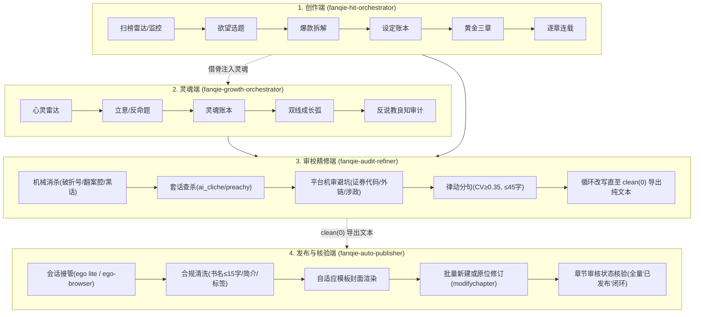

# 番茄小说全流程创作、多维精修与自动化发布套件（Fanqie Novel Skills）

面向**番茄小说**创作者与 AI Agent 的全流程写作、审校精修与自动化发布总控引擎，遵循 Antigravity / Agent Skills 规范（`skills/<name>/SKILL.md` + `references/` + `templates/` + `scripts/`）。

| Skill | 方向 | 核心定位与公式 |
| :--- | :--- | :--- |
| [`fanqie-hit-orchestrator`](skills/fanqie-hit-orchestrator/SKILL.md) | **爆款 · 欲望满足向** | 欲望靶点 × 压抑-兑现周期 × 强钩子追读力（P0~P6 创作总控） |
| [`fanqie-growth-orchestrator`](skills/fanqie-growth-orchestrator/SKILL.md) | **灵魂 · 真我与良知向** | 真实困境 × 错误信念被击碎 × 主动选择 × 反爹味良知回响 |
| [`fanqie-audit-refiner`](skills/fanqie-audit-refiner/SKILL.md) | **精修 · 多维专业审校** | write机械消杀 × 番茄套话过滤 × 平台机审合规 × 循环精修直至 clean(0) |
| [`fanqie-auto-publisher`](skills/fanqie-auto-publisher/SKILL.md) | **落地 · 自动化发布与闭环** | 会话动态接管 × 批量发书/原位更新 × 章节审核状态核验（全量“已发布”） |

---

## 全流程闭环架构



---

## 目录结构

```
skills/
├── fanqie-hit-orchestrator/      # 爆款欲望向双轴创作总控 (P0-P9)
│   ├── SKILL.md
│   ├── references/               01-desire-map … 06-trend-radar
│   ├── templates/                state / book-bible / chapter-outline / audit-report / trend-report
│   └── scripts/                  text_lint.ps1 · rank_diff.ps1 · lexicons/
├── fanqie-growth-orchestrator/   # 成长良知向总控
│   ├── SKILL.md
│   ├── references/               01-inner-need-map … 05-conscience-audit
│   ├── templates/                soul-bible / growth-outline / dual-audit-report
│   └── scripts/lexicons/         preachy.txt
├── fanqie-audit-refiner/         # 多维专业审校与去 AI 味精修总控
│   ├── SKILL.md
│   ├── README.md
│   ├── references/               01-anti-ai-patterns.md · 02-platform-compliance-matrix.md · 03-sentence-rhythm-and-mobile.md
│   ├── templates/                audit-report.md
│   └── scripts/                  audit_check.py · auto_refine.py
└── fanqie-auto-publisher/        # 作家专区自动化发书、原位修订与状态核验总控
    ├── SKILL.md
    ├── README.md
    ├── scripts/                  publish-to-fanqie.mjs · update-chapters.mjs · verify-chapters.mjs
    └── references/               01-fanqie-platform-rules.md · 02-browser-automation.md
```

---

## 核心审校指标与准出闸口

| 维度 | 检查项 | 准出要求 | 判定工具 |
| :--- | :--- | :---: | :--- |
| **机械去AI味** | 破折号（`——`、`—`）、翻案腔（`不是…而是`、`不仅…更是`）、提示性冒号、口头路标 | **0 命中** | `fanqie-audit-refiner/scripts/audit_check.py` |
| **语境黑话** | 现代违和词（赛道、生态、赋能、闭环、助力、打造） | **0 命中** | 还原为年代实体动作 |
| **网文套话** | 眸子、嘴角勾起、倒吸一口凉气、深吸一口气、命运的齿轮、掷地有声 | **0 命中** | `fanqie-hit-orchestrator/scripts/lexicons/ai_cliche.txt` |
| **反爹味说教** | 唯有、暗暗发誓、做人要、章尾导师大道理升华 | **0 命中** | 画面悬念收束，`preachy.txt` 清零 |
| **平台机审风控** | 真实股票代码格式（如 `(02020.HK)`）、域名外链、国家敏感职务全称、连载中完本标记 | **0 命中** | 杜绝番茄后台“审核不通过” |
| **移动端律动** | 单句字数 > 45 字长句、句长变异系数 $CV$ | **长句=0, $CV \ge 0.35$** | 短促有力，适合大拇指翻页 |
| **综合档位** | check 综合扣分 | **clean (0)** | 达标后方可进入发布流程 |

---

## 命令行与自动化调用

### 1. 章节体检与循环精修
```bash
# 单章/批量多维体检
python3 skills/fanqie-audit-refiner/scripts/audit_check.py novels/<书名>/03-chapters/

# 自动精修并同步导出发布文本至 05-fanqie-upload/
python3 skills/fanqie-audit-refiner/scripts/auto_refine.py novels/<书名>/03-chapters/ --export-dir novels/<书名>/05-fanqie-upload/

# 严格模式验证（非 clean(0) 退出码为 1）
python3 skills/fanqie-audit-refiner/scripts/audit_check.py novels/<书名>/03-chapters/ --clean
```

### 2. 自动化发书、原位修订与状态核验
在已登录番茄作家专区（`https://fanqienovel.com/main/writer/home`）的宿主环境执行：
```bash
# 批量新建作品与首发章节
ego-browser nodejs -e "const { publishNovel } = await import('./skills/fanqie-auto-publisher/scripts/publish-to-fanqie.mjs'); await publishNovel({ ... });"

# 批量原位更新已发布章节（精修版重传）
ego-browser nodejs -e "const { updateChapters } = await import('./skills/fanqie-auto-publisher/scripts/update-chapters.mjs'); await updateChapters({ bookId: '7706576388727262232', chapters: [...] });"

# 核验全量章节审核状态（确认全部显示“已发布”）
ego-browser nodejs -e "const { verifyChapterStatus } = await import('./skills/fanqie-auto-publisher/scripts/verify-chapters.mjs'); await verifyChapterStatus({ bookId: '7706576388727262232' });"
```

---

## 边界与声明

- 榜单数据只来自公开页面人工记录、作者后台或用户提供；**不包含**字体反混淆、APP 协议抓取等绕过平台防护的采集。
- 拆解遵循"借骨不借肉"：学结构，不复制文字与独创设定。
- 自动化发布与原位更新基于本地会话驱动，不破解验证码，遇到人机安全质询遵循 handoff 机制移交人工处理。
- 平台审核规则以番茄作家专区最新《作家福利与内容审核规范》为准。
