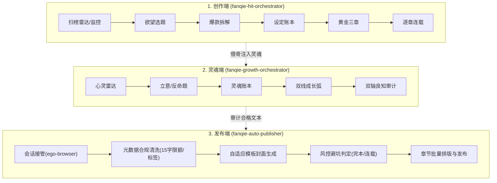

# 番茄小说全流程创作与发布套件（Fanqie Novel Skills）

面向**番茄小说**创作者与 AI Agent 的全流程写作、审计与自动化发书总控引擎，遵循 Antigravity / Agent Skills 规范（`skills/<name>/SKILL.md` + `references/` + `templates/` + `scripts/`）。

| Skill | 方向 | 核心定位与公式 |
| :--- | :--- | :--- |
| [`fanqie-hit-orchestrator`](skills/fanqie-hit-orchestrator/SKILL.md) | **爆款 · 欲望满足向** | 欲望靶点 × 压抑-兑现周期 × 强钩子追读力 |
| [`fanqie-growth-orchestrator`](skills/fanqie-growth-orchestrator/SKILL.md) | **成长 · 真我与良知向** | 真实困境 × 错误信念被击碎 × 主动选择 × 良知回响 |
| [`fanqie-auto-publisher`](skills/fanqie-auto-publisher/SKILL.md) | **落地 · 自动化发布向** | 会话动态接管 × 字段合规清洗 × 模板封面渲染 × 逐章批量发布 |

---

## 全流程闭环架构



---

## 目录结构

```
skills/
├── fanqie-hit-orchestrator/      # 爆款欲望向双轴创作总控
│   ├── SKILL.md
│   ├── references/               01-desire-map … 06-trend-radar
│   ├── templates/                state / book-bible / chapter-outline / audit-report / trend-report
│   └── scripts/                  text_lint.ps1 · rank_diff.ps1 · lexicons/
├── fanqie-growth-orchestrator/   # 成长良知向总控
│   ├── SKILL.md
│   ├── references/               01-inner-need-map … 05-conscience-audit
│   ├── templates/                soul-bible / growth-outline / dual-audit-report
│   └── scripts/lexicons/         preachy.txt
└── fanqie-auto-publisher/        # 作家专区自动化发书与章节上传总控
    ├── SKILL.md
    ├── README.md
    ├── scripts/                  publish-to-fanqie.mjs
    └── references/               01-fanqie-platform-rules.md · 02-browser-automation.md
```

---

## 安装与快速使用

### 作为 Antigravity Plugin 安装
把本项目放置于 `~/.gemini/config/plugins/fanqie-novel-skills`，Antigravity 与 Agent 即可自动发现并加载全量技能。

### 自动化发布脚本调用
在已登录番茄作家专区（`https://fanqienovel.com/main/writer/home`）的宿主环境执行：
```powershell
& "C:\Program Files\Citro Labs\ego lite\Application\0.6.2.7\ego-browser.exe" nodejs -e "await import('file:///C:/Users/Admin/.gemini/config/plugins/fanqie-novel-skills/skills/fanqie-auto-publisher/scripts/publish-to-fanqie.mjs')"
```

---

## 文本与榜单工具脚本（PowerShell 5.1+，无需 Python）

```powershell
# 章节体检：字数、段落、对话占比、AI味/风险词、章尾钩子
powershell -ExecutionPolicy Bypass -File skills/fanqie-hit-orchestrator/scripts/text_lint.ps1 -Path 第001章.md -Out lint.md
# 叠加说教词库（成长向）
powershell -ExecutionPolicy Bypass -File skills/fanqie-hit-orchestrator/scripts/text_lint.ps1 -Path 第010章.md -Lexicon skills/fanqie-growth-orchestrator/scripts/lexicons/preachy.txt
# 榜单快照：模板 / 对比 / 标签热度
powershell -ExecutionPolicy Bypass -File skills/fanqie-hit-orchestrator/scripts/rank_diff.ps1 -Mode template -Out 2026-11-10_男频新书榜.csv
powershell -ExecutionPolicy Bypass -File skills/fanqie-hit-orchestrator/scripts/rank_diff.ps1 -Mode diff -Old 旧.csv -New 新.csv -Out 变化.md
powershell -ExecutionPolicy Bypass -File skills/fanqie-hit-orchestrator/scripts/rank_diff.ps1 -Mode tags -New "a.csv,b.csv" -Out 标签热度.md
```

---

## 边界与声明

- 榜单数据只来自公开页面人工记录、作者后台或用户提供；**不包含**字体反混淆、APP 协议抓取等绕过平台防护的采集。
- 拆解遵循"借骨不借肉"：学结构，不复制文字与独创设定。
- 自动化发书基于本地会话驱动，不破解验证码，遇到人机安全质询遵循 handoff 机制移交人工处理。
- 参考文件中的字数、比例、节点均为行业经验值，非番茄官方标准；合规以番茄作家后台最新《内容规范》为准。
