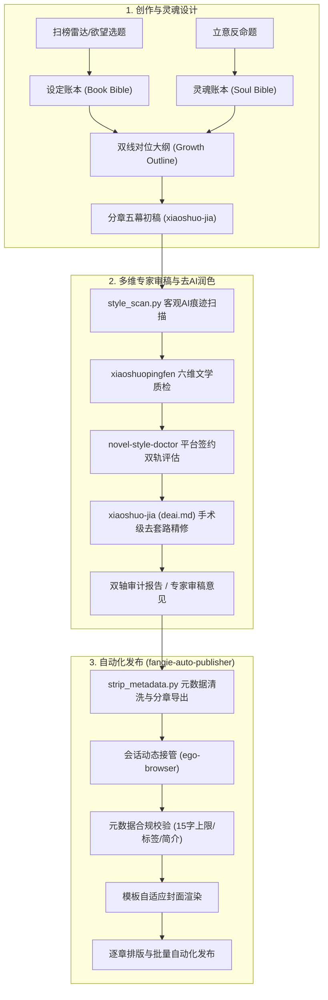

# 番茄小说全流程创作、审计、润色与发布套件（Fanqie Novel Skills）

面向**番茄小说**创作者与 AI Agent 的全流程写作、文风诊断、去AI味手术级润色、多维专家审稿与自动化发书总控引擎，遵循 Antigravity / Agent Skills 规范（`skills/<name>/SKILL.md` + `references/` + `templates/` + `scripts/`）。

## 技能矩阵与职能划分

| 阶段 | Skill | 方向 / 职能 | 核心定位与公式 |
| :--- | :--- | :--- | :--- |
| **1. 欲望总控** | [`fanqie-hit-orchestrator`](skills/fanqie-hit-orchestrator/SKILL.md) | **爆款 · 欲望满足向** | 欲望靶点 × 极短压抑-兑现周期 × 强钩子追读力 |
| **2. 灵魂立意** | [`fanqie-growth-orchestrator`](skills/fanqie-growth-orchestrator/SKILL.md) | **成长 · 真我与良知向** | 真实困境 × 错误信念被击碎 × 主动选择 × 良知回响 |
| **3. 文风体检** | [`novel-style-doctor`](skills/novel-style-doctor/SKILL.md) | **诊断 · 签约竞争力向** | AIGC客观特征值扫描 + 文学/平台双轨评分（100+100） + 完读率模型 |
| **4. 创作与润色** | [`xiaoshuo-jia`](skills/xiaoshuo-jia/SKILL.md) | **全流程 · 手术级去AI味** | 2200-2800字/章字数纪律 + 钩子轮换 + `deai.md` 手术级去套路化润色 |
| **5. 深度评审** | [`xiaoshuopingfen`](skills/xiaoshuopingfen/SKILL.md) | **量化 · 六维质量评审** | 情节(25)、人物(20)、文笔(15)、世界观(15)、情感(15)、创新(10) |
| **6. 终端发布** | [`fanqie-auto-publisher`](skills/fanqie-auto-publisher/SKILL.md) | **落地 · 自动化发布向** | 会话动态接管 × 字段合规清洗 × 模板封面渲染 × 逐章批量发布 |

---

## 全流程闭环架构



---

## 目录结构

```
skills/
├── fanqie-hit-orchestrator/      # 爆款欲望向双轴创作总控
│   ├── SKILL.md
│   ├── references/               01-desire-map … 06-trend-radar
│   ├── templates/                state / book-bible / chapter-outline / audit-report / trend-report
│   └── scripts/                  text_lint.ps1 · rank_diff.ps1 · lexicons/
├── fanqie-growth-orchestrator/   # 成长良知向总控
│   ├── SKILL.md
│   ├── references/               01-inner-need-map … 05-conscience-audit
│   ├── templates/                soul-bible / growth-outline / dual-audit-report
│   └── scripts/lexicons/         preachy.txt
├── novel-style-doctor/           # 网文文风医生与签约参谋
│   ├── SKILL.md
│   ├── references/               scoring-rubric.md · style-principles.md · tomato-evaluator.md
│   └── scripts/                  style_scan.py
├── xiaoshuo-jia/                 # 长篇网文全流程与去AI润色专家
│   ├── SKILL.md
│   ├── references/               deai.md · evaluation.md · planning.md · publishing.md
│   ├── templates/                chapter-template.md · outline-template.md
│   └── scripts/                  hook_rotation_check.py · strip_metadata.py · wordcount_check.py
├── xiaoshuopingfen/              # 专业小说六维评分系统 (novel-evaluator-pro)
│   └── SKILL.md                  情节/人物/文笔/世界观/情感/创新 6维量化打分
└── fanqie-auto-publisher/        # 作家专区自动化发书与章节上传总控
    ├── SKILL.md
    ├── references/               01-fanqie-platform-rules.md · 02-browser-automation.md
    └── scripts/                  publish-to-fanqie.mjs
```

---

## 安装与快速使用

### 作为 Antigravity Plugin 安装
本项目位于 `~/.gemini/config/plugins/fanqie-novel-skills`，Antigravity 与各类 Agent 即可自动发现并加载全量 6 大技能。

### 自动化发布脚本调用
在已登录番茄作家专区（`https://fanqienovel.com/main/writer/home`）的环境中执行：
```powershell
& "C:\Users\Admin\AppData\Local\Programs\ego-lite\ego-browser.exe" nodejs -e "await import('file:///C:/Users/Admin/.gemini/config/plugins/fanqie-novel-skills/skills/fanqie-auto-publisher/scripts/publish-to-fanqie.mjs')"
```

---

## 边界与声明

- 榜单数据只来自公开页面人工记录、作者后台或用户提供；不包含破解防爬协议或未经许可的采集。
- 去AI味严格执行 `deai.md` 铁律：**不破坏文风、不破坏字数控、不破坏对话**，反对大面积推倒重写的破坏性 churn。
- 自动化发书基于本地浏览器已授权会话驱动，不破解验证码，遇到人机安全质询遵循 handoff 机制移交人工处理。
- 所有参考标准、字数区间与模型评分均依据番茄小说最新签约与审核规则。
