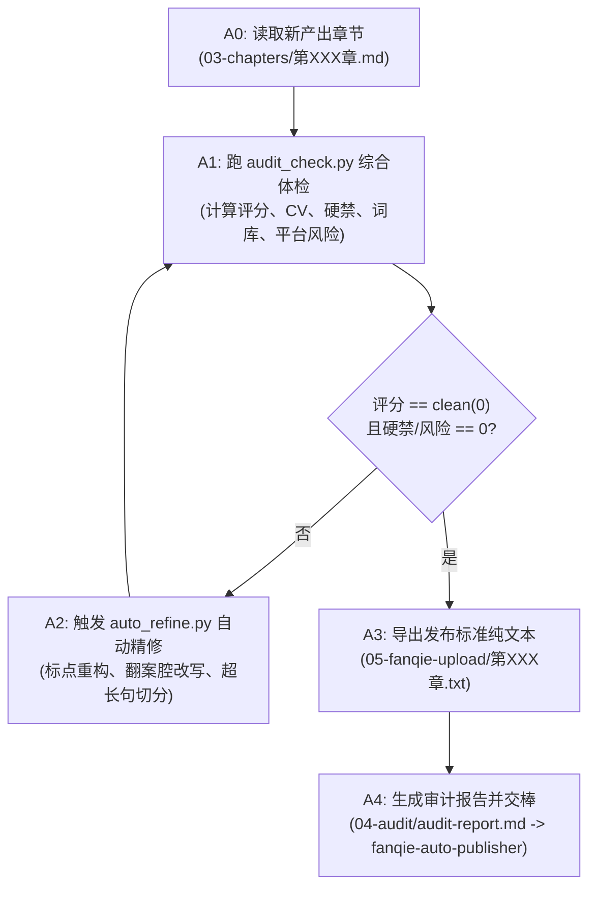

# 番茄小说全流程专业审校与精修技能（Fanqie Audit Refiner）

> **定位**：在小说创作（P6）完成后，提供自动化、多维度、出版级的审校体检与去 AI 味精修闭环，杜绝任何 AI 机械腔调与合规风险，直达番茄作家专区“免审核/秒过审”标准。
> **核心指标**：`write 评分 = clean(0) ｜ 硬禁项 = 0 ｜ 平台风控 = 0 ｜ 套话说教 = 0 ｜ 句长 CV ≥ 0.35 ｜ 单句 ≤ 45 字`

---

## 一、 技能融合矩阵

本技能由真实爆款连载实战沉淀而来，深度整合以下专业能力：

1. **`write`（中文机械消杀引擎）**：
   - 查杀所有破折号 `——`、`—`、`–`（替换为冒号、短句或声效感叹）。
   - 查杀所有翻案腔（`不是…而是…`、`不仅…更是…`、`并非`、`表面…实则`）。
   - 查杀提示性冒号（`关键是：`、`核心在于：`）与公文式口头路标（`不可否认的是`、`首先其次`）。
   - 置换现代黑话宣传语（`赛道`→`跑道`、`生态`→`现代花园式`、`助力`→`助推`、`打造`→`造出`）。
   - 消杀泛滥空洞比喻（`宛如`、`犹如`、`如同`、`仿佛`、`护航`、`注入活力`）。
2. **`fanqie-hit-orchestrator`（爆款网文套话雷达）**：
   - 扫描 `ai_cliche.txt`（`眸子`、`嘴角勾起`、`倒吸一口凉气`、`深吸一口气`、`命运的齿轮`、`掷地有声`等）。
   - 扫描 `risk_words.txt`（暴力、涉赌、涉毒、私刑细节合规过滤）。
3. **`fanqie-growth-orchestrator`（反爹味与叙事升华引擎）**：
   - 扫描 `preachy.txt`（`唯有`、`暗暗发誓`、`做人要`、`其实我们`）。
   - 落实 `04-anti-preachiness.md`：严禁章末导师式说教升华，统一改用 1990 年代具象工业/生活画面与动作悬念收束。
4. **番茄作家后台官方机审合规雷达**：
   - 拦截真实股票代码与域名外链（如 `（02020.HK）`、`.com`、`.cn`）。
   - 拦截真实国家高层公职全称与名校争议（虚构化为“国家体育部门”、“京华大学”）。
   - 连载中严禁在正文打完结后缀（如 `（全书完）`）。
5. **生态技能发现（`skill-finder` / `find-skills` 规范）**：
   - 动态衔接 `jwynia/agent-skills@novel-revision`、`wordflowlab/novel-writer-skills@story-consistency-monitor`、`danjdewhurst/story-skills@editorial-review` 的编辑复核原则。

---

## 二、 自动化闭环执行流程（A0 - A4）



### 命令行调用：

```bash
# 1. 章节多维体检
python3 skills/fanqie-audit-refiner/scripts/audit_check.py novels/<书名>/03-chapters/第001章.md

# 2. 全量章节自动精修并同步导出至发布目录
python3 skills/fanqie-audit-refiner/scripts/auto_refine.py novels/<书名>/03-chapters/ --export-dir novels/<书名>/05-fanqie-upload/

# 3. 严格验证全量章节 clean(0) 状态
python3 skills/fanqie-audit-refiner/scripts/audit_check.py novels/<书名>/03-chapters/ --clean
```

---

## 三、 章节质量准出闸口（必须 100% 达标）

- [ ] **汉字字数**：单章汉字数 ≥ 2,000 字（通常 2,100 ~ 3,500 字）。
- [ ] **章节标题**：中文字符数 ≤ 15 字（含标点）。
- [ ] **check 评分**：档位必须为 `clean (0)`。
- [ ] **硬禁项命中**：`破折号=0`、`翻案腔=0`、`提示性冒号=0`、`口头路标=0`。
- [ ] **平台风控命中**：`真实证券代码/外链=0`、`敏感涉政公职全称=0`、`完本标记=0`。
- [ ] **套话与说教命中**：`ai_cliche=0`、`preachy=0`。
- [ ] **句长与律动**：`超长句(>45字)=0`，单句长度变异系数 $CV \ge 0.35$。
- [ ] **章末收尾**：停留于具体画面或下一阶段危机信号，绝无人生大道理导师独白。
