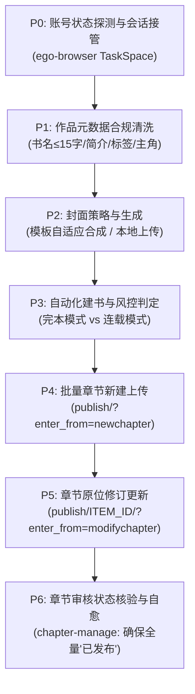

# 番茄小说自动发布与章节上传技能（Fanqie Auto Publisher）

本技能专门用于将已创作并经 `fanqie-audit-refiner` 精修达标的小说作品及其章节，通过自动化接管运行中的 **ego lite** / **ego-browser**，全自动发布至**番茄小说作家专区**（`https://fanqienovel.com/main/writer/home`），并持续核验审核状态直至全量章节全部变为“已发布”。

---

## 核心能力与适用场景

1. **零配置浏览器接管**：通过 `ego-browser nodejs` 动态接管作者已登录的 ego lite 浏览器会话，无须重新登录或暴露密码与 Cookie。
2. **字段规范与合规清洗**：
   - **书名自动截断/精炼**：严格适配番茄 15 汉字上限限制。
   - **爆款简介生成**：自动适配 50~500 字黄金钩子，剔除违禁词。
   - **多级标签自动化**：主分类（必选1）+ 主题/角色/情节（最多各2）+ 情感（最多2）+ 世界观（最多1）。
3. **封面自适应生成**：支持调用番茄内置模板封面自动排版合成书名，免去手工做封面的繁琐。
4. **风控探测与优雅避坑**：
   - 自动探测账号等级（Lv.0~Lv.5）、实名状态（`is_auth`）。
   - 自动识别“完本模式每日限额 1 本”限制并智能切换连载模式或提示明日重置。
   - 遇人机验证时自动调用协同 handoff，不强破安全策略。
5. **批量章节排版与发布**：
   - 自动剥离 Markdown 符号，清洗为符合番茄后台编辑器的纯文本分段。
   - 自动填入第 N 章与章节标题，批量存草稿或直接公开发布。
6. **现有章节原位修订（In-place Modify）**：
   - 支持对已发布的章节进行精准原位重新编辑提交（`/publish/<item_id>/?enter_from=modifychapter`），便于快速推送审校精修后的文本。
7. **章节审核状态闭环核验（Status Verification）**：
   - 自动化回读 `chapter-manage` 表格，提取全书章节状态，确认全部处于“已发布”；若有“审核不通过”自动告警并定位 Item ID 触发自愈修复。

---

## 执行流程（P0 - P6）



### 自动化脚本调度

```bash
# 1. 自动化建书与批量首发
ego-browser nodejs -e "const { publishNovel } = await import('./scripts/publish-to-fanqie.mjs'); await publishNovel({ ... });"

# 2. 批量章节原位更新（精修版重传）
ego-browser nodejs -e "const { updateChapters } = await import('./scripts/update-chapters.mjs'); await updateChapters({ bookId: '...', chapters: [...] });"

# 3. 章节发布与审核状态核验
ego-browser nodejs -e "const { verifyChapterStatus } = await import('./scripts/verify-chapters.mjs'); await verifyChapterStatus({ bookId: '...' });"
```

---

## 边界与安全准则

1. **会话安全**：仅接管作者已显式在 ego lite 中登录的本地环境，不外传 Cookie 或凭据。
2. **合规第一**：严格遵守番茄小说作家专区《内容与格式规范》，不抓取非公开接口，不绕过人机挑战。
