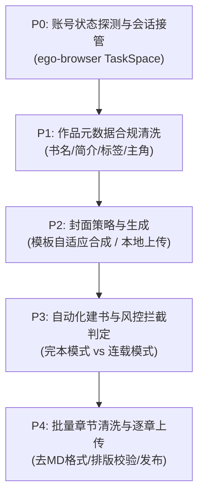

# 番茄小说自动发布与章节上传技能（Fanqie Auto Publisher）

本技能专门用于将已完成或连载中的小说作品及其章节，通过自动化接管运行中的 **ego lite** 浏览器，全自动发布至**番茄小说作家专区**（`https://fanqienovel.com/main/writer/home`）。

---

## 核心能力与适用场景

1. **零配置浏览器接管**：通过 `ego-browser.exe` 动态接管作者已登录的 ego lite 浏览器会话，无须重新登录或暴露密码与 Cookie。
2. **字段规范与合规清洗**：
   - **书名自动截断/精炼**：严格适配番茄 15 汉字上限限制。
   - **爆款简介生成**：自动适配 50~500 字黄金钩子，剔除违禁词。
   - **多级标签自动化**：主分类（必选1）+ 主题/角色/情节（最多各2）+ 情感（最多2）+ 世界观（最多1）。
3. **封面自适应生成**：支持调用番茄内置模板封面自动排版合成书名，免去手工做封面的繁琐。
4. **风控探测与优雅避坑**：
   - 自动探测账号等级（Lv.0~Lv.5）、实名状态（`is_auth`）。
   - 自动识别“完本模式每日限额 1 本”限制并智能切换连载模式或提示明日重置。
   - 遇人机验证时自动调用协同 handoff，不强破安全策略。
5. **批量章节排版与发布**：
   - 自动剥离 Markdown 符号，清洗为符合番茄后台编辑器的纯文本分段。
   - 自动填入第 N 章与章节标题，批量存草稿或直接公开发布。

---

## 执行流程（P0 - P4）



### P0：会话接管与状态探测
- 使用 Node.js 运行自动化脚本：
  ```bash
  & "C:\Program Files\Citro Labs\ego lite\Application\0.6.2.7\ego-browser.exe" nodejs -e "await import('file:///path/to/publish-to-fanqie.mjs')"
  ```
- 探测账号信息接口 `/api/author/account/info/v0/`：
  - `can_create_serial_book`：连载模式可用性
  - `is_auth`：实名认证状态
  - `author_level_id`：作者等级

### P1：元数据合规清洗
- **书名**：必须 ≤ 15 字（中英文、数字及基础标点）。
- **目标读者**：男频（1）/ 女频（0）。
- **阅读标签**：
  - 主分类：如 `年代`、`种田`、`现言脑洞`、`玄幻言情` 等。
  - 情节/主题：如 `发家致富`、`重生`、`职场商战`。
- **内容标签**：
  - 世界观：`80年代`、`70年代`、`四合院` 等。
  - 情感：`无CP`、`独宠`、`先婚后爱` 等。
- **作品简介**：50~500 字，按“现状困境 + 金手指打破 + 极限反转/爽点展望”3段式排布。

### P2：封面自适应生成
- 切换至“模板封面”选项卡。
- 选定匹配风格的底图模版，番茄后台前端 canvas 自动将书名居中排版并上传至 CDN。

### P3：建书提交与异常处理
- 点击“立即创建”。
- 若提示 `创建完本模式作品数超出每日上限`：告知作者当日限额已满，等待次日 00:00 自动刷新后重试，或完成实名认证解锁连载多书权限。

### P4：章节批量发布
- 遍历 `05-fanqie-upload/` 下各章节文档。
- 读取每章标题与正文。
- 调用章节发布接口或页面自动化逐章提交。

---

## 边界与安全准则

1. **会话安全**：仅接管作者已显式在 ego lite 中登录的本地环境，不外传 Cookie 或凭据。
2. **合规第一**：严格遵守番茄小说作家专区《内容与格式规范》，不抓取非公开接口，不绕过人机挑战。
